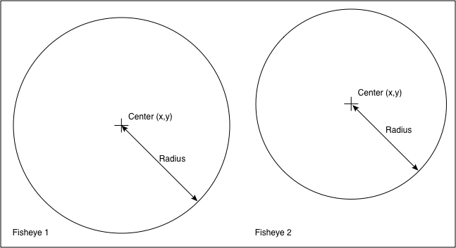
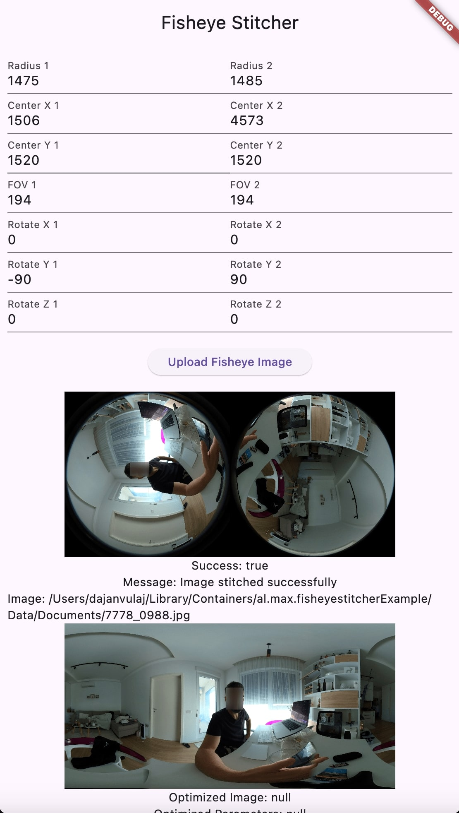

# Fisheye Stitcher

A Dart plugin for stitching dual fisheye images into a spherical (equirectangular) image.


# Features

- Stitch fisheye images with ease
- Set the belding width, in order to fade out the stitching errors
- Auto optimization of the parameters


## Example

```dart
import 'package:fisheye_stitcher/fisheye_stitcher.dart';
```

```dart
StitchingResult stitchingResult =
    await fisheye_stitcher.stitchFisheyeImages(
  fisheye1Parameters: fisheye_stitcher.createFishEyeParams(
    imagePath: image.path,
    radius: int,
    centerX: int,
    centerY: int,
    fov: double,
    /// The transform array is needed only if the camera lenese need correction
    /// Usually they do, as it's almost impossible for the camera factories to align the lenses perfectly
    /// In the transform array you can pass multiple rotations in different order 
    /// (This is helpful if you use the optimization function, that will generate new parameters and rotations)
    transform: [
      [ROTATEY, double],
      [ROTATEZ, double],
      [ROTATEX, double],
    ],
  ),
  fisheye2Parameters: fisheye_stitcher.createFishEyeParams(
    imagePath: image.path,
    radius: int,
    centerX: int,
    centerY: int,
    fov: double,
    transform: [
      [ROTATEY, double],
      [ROTATEZ, double],
      [ROTATEX, double],
    ],
  ),
  outputWidth: 2000,
  outputHeight: 0,
  enableDebugging: false,
  /// If the numberOfOptimizationIterations parameter is greater then 1, the script will start an auto-optimization
  /// process. This will take time (The greater the numberOfOptimizationIterations,
  /// the greater the optimized result will be)
  numberOfOptimizationIterations: 1
);
```

To generate the params, use photoshop



    - The function requires parameters for 2 fisheye images.
    - You can use 1 image if it has both fisheyes inside.
    - centerX and centerX are the center coordinates in px's of the fisheye image (origin is the top left corner of the image)
    - radius , is the radius of the fisheye
    - fov, is the cameras field of view

## DEMO (Example App)


# License

jpegtran_ffi code is licensed under the 3-Clause BSD License.
Please do note that it is a wrapper around libjpeg-turbo - so please see [its license](https://github.com/libjpeg-turbo/libjpeg-turbo/blob/ab6c4a5db10901fa2ae9e8594768175e02b6e016/LICENSE.md)
